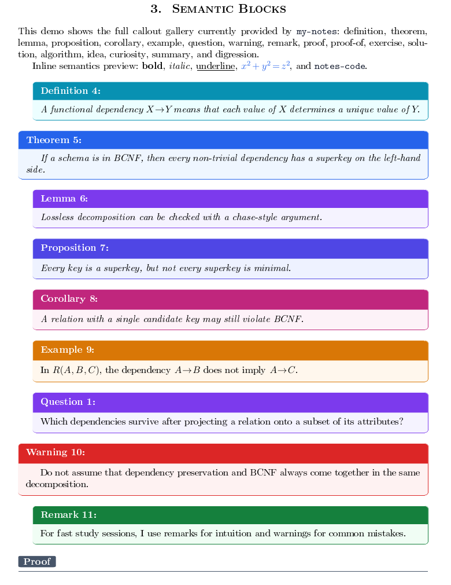
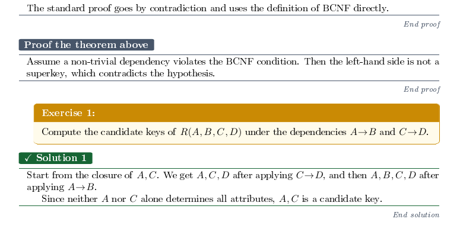

# My Notes

A note-taking package for GNU TeXmacs by Jacopo Rizzuto. It adds colored semantic blocks to `tmarticle`, plus personal insertion commands and startup helpers. The package uses native TeXmacs markup; the example document is editable.





## Contents

- `packages/my-notes.ts`: colors, callouts, proof and solution rendering, inline helpers, and the `notes-paper-card` macro.
- `progs/my-init-texmacs.scm`: insertion commands, including `\wt` for a native two-column wide table, and optional keyboard shortcuts.
- `progs/my-init-buffer.scm`: adds `my-notes` to new article buffers. Set `my-notes-auto-apply?` to `#f` in `my-init-texmacs.scm` to disable this behavior.
- `examples/demo-note.tm`: an editable gallery of the semantic blocks and insertion examples.
- `scripts/`: installers for Linux, Arch Linux, and Windows. They make timestamped backups of files they replace.

## Install

For the visual package alone, copy `packages/my-notes.ts` to your personal TeXmacs `packages` directory. In a document, select `tmarticle` and add `my-notes` as a package. Open `examples/demo-note.tm` to inspect the result.

For the insertion commands and automatic setup, install all three files using one of the scripts from this directory:

```sh
./scripts/install.sh       # Linux
./scripts/install-arch.sh  # Arch Linux
```

On Windows, run `scripts/install.ps1` in PowerShell. The scripts accept `TEXMACS_HOME_PATH` to select a different personal TeXmacs directory. Review the startup helpers before installing them: they also set global LaTeX clipboard shortcuts and change where the **Link all embedded images** command stores extracted files. Restart TeXmacs after installation.

## Examples and rendering

The screenshots come from pages 2 and 3 of `examples/demo-note.tm`, exported with TeXmacs 2.1.4. Page 3 is cropped to show the proof and solution blocks. The demo contains generic database examples and no personal notes.

The package keeps the standard TeXmacs environment names, including `definition`, `theorem`, `example`, `warning`, `proof`, `solution`, `summary`, and `algorithm`. Long proofs and solutions use a page-breakable layout; the framed callouts are best kept short.

The package and demo passed structural checks and a three-page PDF export with TeXmacs 2.1.4 on Linux. Appearance can vary with installed fonts and TeXmacs settings. For the appearance shown here, enable **Plain → Framed theorems** and turn off paragraph indentation.
